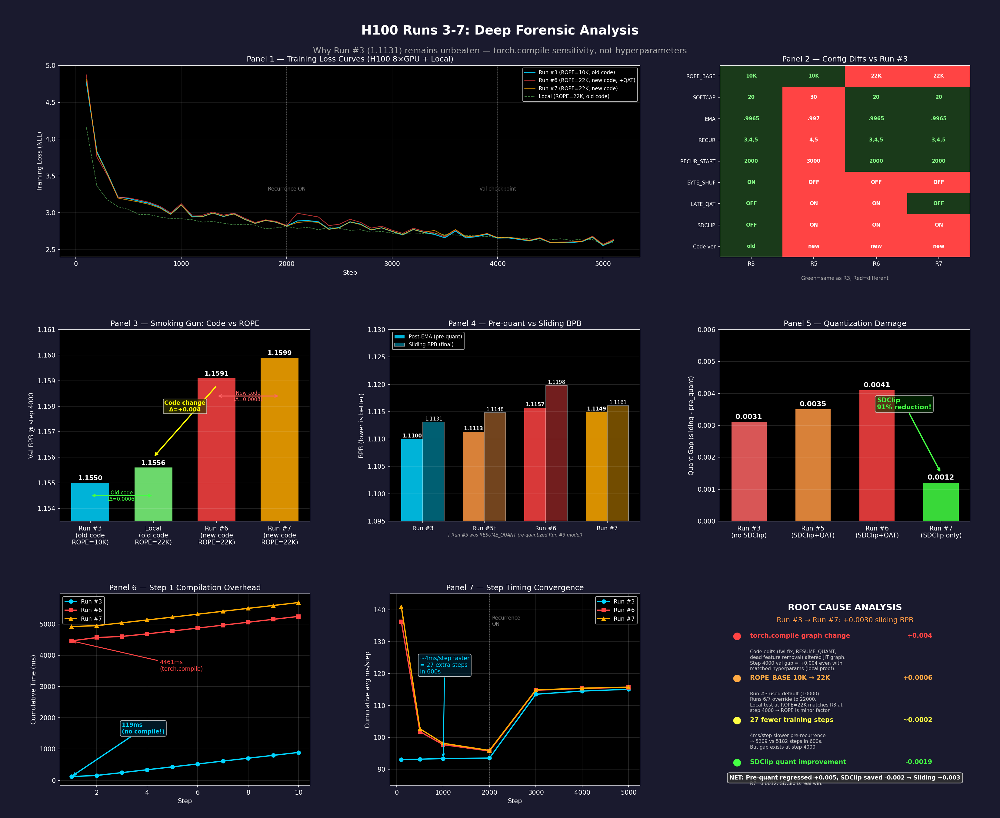

# parameter-golf-experiments

My experiments for the [OpenAI Parameter Golf](https://github.com/openai/parameter-golf) competition, from March to April 2026.

The task: train the language model with the lowest bits per byte (BPB) on the FineWeb validation set. The model must meet three limits:

- The artifact (code plus compressed weights) is at most 16,000,000 bytes.
- Training runs in at most 600 seconds on 8xH100 GPUs.
- Evaluation runs in at most 10 more minutes.

This repository is not a fork. It holds my own training pipeline, 14 logged 8xH100 sessions, about 480 local experiment logs, and the analysis. The competition, the baseline `train_gpt.py`, the data pipeline and the rules come from OpenAI's repository (MIT License, see [THIRD_PARTY_NOTICES.md](THIRD_PARTY_NOTICES.md)). Some techniques come from other participants. Each use links to the source pull request.

## Result

My best score was **1.1009 BPB** (Run 10c, with test-time training). The leaderboard leader at that time had 1.0779 ([PR #1541](https://github.com/openai/parameter-golf/pull/1541)). My result did not reach the top of the leaderboard. The value of this repository is in the engineering, the controlled experiments and the documented failures.

| Run | Vocab | Pre-quant BPB | Sliding BPB | TTT BPB | Artifact (bytes) |
|-----|-------|---------------|-------------|---------|------------------|
| 0 | SP1024 | 1.1204 | 1.1461 | 1.1166 | 16,671,332 (over the limit) |
| 3 | SP4096 | 1.1100 | 1.1131 | - | 15,232,121 |
| **10c** | **SP8192** | **1.1033** | **1.1056** | **1.1009** | **15,991,240** |

All values are from one seed. The full table of all runs, with root causes, is in [docs/h100_runs.md](docs/h100_runs.md).

## Model and pipeline

- 11 transformer layers, width 512, grouped-query attention (8 query heads, 4 KV heads).
- Depth recurrence: the model runs a block of middle layers two times per forward pass.
- Parallel residuals (attention and MLP in parallel) from layer 7.
- Partial RoPE, logit softcap, value embeddings, tied embeddings.
- Muon optimizer with EMA weights and a wall-clock-based warmdown.
- GPTQ quantization (int5/int6, real-data Hessians, SDClip), byte-budget pruning and Brotli compression in the last seconds of the run.
- A self-extracting LZMA wrapper reduces the code part of the artifact from 66 KB to 23 KB.
- Score-first test-time training (TTT) at evaluation.

Details: [docs/research_notes/architecture.md](docs/research_notes/architecture.md).

## Main findings

Each finding has its evidence and a confidence note in [docs/findings.md](docs/findings.md).

1. **Int5 attention is almost free.** In a local A/B test, 5-bit attention weights saved 0.94 MB and removed 20% pruning. Roundtrip BPB was 1.1210 against 1.1279.
2. **The vocabulary change was the largest single gain.** SP4096 to SP8192 improved sliding BPB from 1.1131 to 1.1056. At SP8192 the embedding precision decided the budget: int8 forced 41% pruning, int6 forced 2.1%.
3. **Silent configuration drift caused a 4-run regression.** Two launch-script values (`REPEAT_PASS_SCALE`, RoPE base) changed between runs. Run 9 restored both and recovered.
4. **Gradient analysis showed a 2.9x imbalance** between recurrent and parallel layers. Layer-5 attention got zero gradient on the repeat pass.
5. **Grid-pushing regularization conflicts with GPTQ.** A CAGE-style pull toward the quantization grid kept pre-quant BPB but forced 92.6% pruning.
6. **Local results did not transfer to H100 for size and depth.** A 12th layer gained 0.0064 BPB locally and lost 0.0129 roundtrip BPB on H100.
7. **I corrected some of my own claims.** A "91% smaller quantization gap" came from a baseline mismatch. On the same weights, the gain was about 0.0005 BPB.
8. **Three eval-time ideas gave no gain.** These were temperature scaling, multi-layer logit averaging and z-loss. The tests show that the model is already calibrated.

## Infrastructure

- **Local screening** on a 2-GPU workstation (RTX PRO 6000 Blackwell, sm_120). FlashAttention 3 does not run on sm_120, so I wrote a shim with the FlashAttention 3 interface that uses PyTorch SDPA ([src/flash_attn_interface_sdpa_shim.py](src/flash_attn_interface_sdpa_shim.py)).
- **Rented 8xH100 nodes** for the final runs, at about $23 per session. Because each run cost money, every run went through local smoke tests first. I froze the code of each run in its own folder ([runs/](runs/)).
- **Distributed fixes:** NCCL timeouts during GPTQ, rank-0-only quantization, and a `RESUME_QUANT` path. That path re-quantizes a saved checkpoint without a new training run.

Details: [docs/infrastructure.md](docs/infrastructure.md).

## Repository layout

| Path | Content |
|------|---------|
| [src/](src/) | Best training script (Run 10c), unminified development version, LZMA wrapper builder, H100 launch script, SDPA shim, baselines |
| [runs/](runs/) | Code and logs of each 8xH100 run |
| [experiments/](experiments/) | Quantization ablations and eval-time experiments, each with a README and results |
| [sweeps/](sweeps/) | Local sweep scripts and logs (v3 to v11, TTT, budget, early SP1024 sweeps) |
| [analysis/](analysis/) | Log parsers, gradient analysis, H100 prediction, plots, and the parsed CSV files |
| [kernels/](kernels/), [perf/](perf/) | Fused-MLP Triton kernel and `torch.compile` tuning (no gain) |
| [figures/](figures/) | Plots of runs and sweeps |
| [docs/](docs/) | Findings, run history, experiment log, infrastructure, research notes |

## How I worked

I used AI coding assistants (Claude Code) through the project. They wrote and edited much of the code, launched and watched local sweeps, parsed logs, and drafted notes and these documents. I set the direction, chose the experiments and the success criteria, and decided which changes went to the paid H100 runs. I also set the rules for the work, for example frozen run folders and no extrapolation of local compression results. I checked the results against the logs. The work was not an autonomous research loop. Many claims in [docs/findings.md](docs/findings.md) are corrections of earlier wrong conclusions, made after review of the raw logs.

## What I would do differently

- Start from the strongest public recipe earlier, and spend the budget on few, isolated changes.
- Change one variable per H100 run, and diff the launch configuration before each run.
- Run three seeds for each important comparison. All results here come from one seed.

## Reproduce

Get the data from the upstream repository (SP1024) or the `kevclark/parameter-golf` Hugging Face dataset (SP4096, SP8192). Then follow [src/README.md](src/README.md) for a local smoke test and the 8xH100 launch. The repository does not include model weights.
