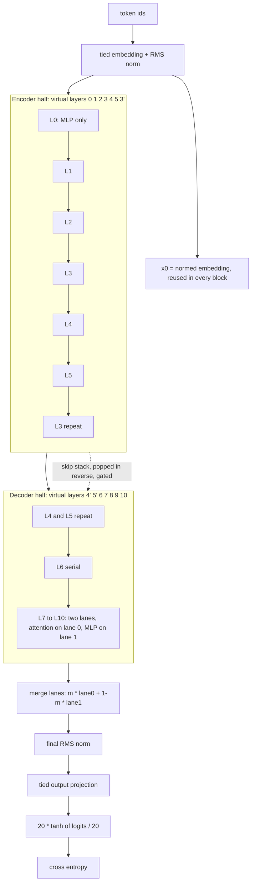

# Architecture

This note describes the model in `src/train_gpt.py` (the Run #10c deployed script). It also notes where `src/train_gpt_readable.py` (the unminified development version from 2026-04-09, Run #3 era, SP4096) differs.

Abbreviations: GQA is grouped-query attention. XSA is exclusive self-attention. VE is value embedding. LoRA is low-rank adaptation. EMA is exponential moving average. TTT is test-time training. RoPE is rotary position embedding.

## Summary

| Item | Run #10c setting |
|---|---|
| Vocabulary | 8192 (SentencePiece BPE), tied input and output embedding |
| Layers | 11 physical, 14 virtual after recurrence starts |
| Model dimension | 512 |
| Attention | 8 query heads, 4 key and value heads (GQA), head dimension 64 |
| MLP | 4x expansion (hidden 2048), no gate, `leaky_relu(x, 0.5)` squared |
| Parameters | 36,064,348 (from the Run #10c log) |
| Recurrence | Layers 3, 4, 5 run twice, switched on at step 2000 |
| Parallel residuals | From layer 7 |
| Layer 0 | Attention disabled |
| XSA | All 11 layers |
| RoPE | 16 of 64 head dimensions rotated, base 10,000 |
| Logit softcap | 20 |
| Value embeddings | Supported, off in Run #10c |
| LoRA on repeat MLP | Rank 16 on the down-projection of the repeated layers |
| Optimizer | Muon for matrix banks, AdamW for the rest, EMA of the weights |
| Quantization | GPTQ, int5 attention, int6 MLP, int6 embedding, then Brotli |
| Evaluation | Sliding window (stride 64), then score-first TTT |

## Forward pass

The weights of the matrix parameters are stored in four banks, one tensor each:

- `qo_bank`, shape (22, 512, 512): query and output projections for the 11 layers.
- `kv_bank`, shape (22, 256, 512): key and value projections.
- `mlp_up_bank`, shape (11, 2048, 512).
- `mlp_down_bank`, shape (11, 512, 2048).

The banks let Muon process all layers of one kind in a batch. A recurrence pass reuses the weights of its physical layer.



The diagram is a simplification. The next sections give the exact rules.

### Virtual layer order

With recurrence off, the model runs layers 0 to 10 once. With recurrence on, the repeated layers are inserted after layer 5:

```
virtual layers: 0 1 2 3 4 5 | 3' 4' 5' | 6 7 8 9 10     (14 in total)
```

The first half of the virtual list (7 layers: 0, 1, 2, 3, 4, 5, 3') is the encoder half. Each encoder output is pushed on a stack. The second half (4', 5', 6 to 10) is the decoder half. Both lanes start from the same state when the first parallel layer begins.

### One block (serial layers)

For input `x` and the first embedding `x0`:

```
xi = mix[0] * x + mix[1] * x0                 # per-dimension residual mix, init (1, 0)
x  = xi + attn_scale * Attn(RMSNorm(xi))      # skipped in layer 0
x  = x  + mlp_scale  * MLP(RMSNorm(x))
```

`attn_scale` and `mlp_scale` are learned per-dimension vectors. Layer-norm scaling by `1/sqrt(layer + 1)` exists in the code (`LN_SCALE`). The Run #10c script leaves it off.

### Attention

- Queries, keys and values come from the banks. Keys and values have 4 heads. The 8 query heads share them in groups of two.
- Queries and keys pass through RMS norm. A learned gain per query head (`q_gain`, initial value 5.0) scales the queries.
- RoPE rotates 16 of the 64 head dimensions. The other 48 pass through unchanged.
- The attention call is `flash_attn_func(q, k, v, causal=True)`. On the local workstation this goes to the SDPA shim.
- XSA removes the component of the output along the normalized value vector of the same group: `y = y - (y . v_hat) * v_hat`. It applies to all 11 layers.
- Layer 0 has no attention. Its block applies only the MLP.

### MLP

The MLP computes `down(leaky_relu(up(x), 0.5)^2)`. See [activation_functions.md](activation_functions.md).

### Skip connections

The decoder half pops the encoder stack. For the first five decoder layers the model blends a scaled skip into the current state with a learned sigmoid gate:

```
skip   = skip_weights[i] * popped_encoder_output
target = lerp(skip, target, sigmoid(skip_gates[i]))
```

The gate starts at zero, so the blend starts at one half.

### Recurrence

Layers 3, 4 and 5 run a second time after layer 5. Recurrence starts at step 2000 (`RECUR_START_STEP`). Before that step the model has 11 layers. The change at step 2000 raises the step time from about 93 ms to about 112 to 118 ms on an H100.

Two additions make the repeated pass different from the first pass:

- **LoRA on the MLP down-projection.** On a repeat pass, the down weight is `mlp_down_bank[layer] + A @ B`. `A` has shape (3, 512, 16) and `B` has shape (3, 16, 2048). `B` starts at zero. The adapter adds little to the artifact size. The repeated MLP then has its own small correction.
- **Per-pass scale (`REPEAT_PASS_SCALE=1`).** After a repeat pass the state becomes `before + s * (after - before)` with a learned scalar `s` per repeated layer.

### Parallel residuals

From layer 7 the decoder splits into two lanes, `lane0` and `lane1`:

```
ai    = mix0 * lane0 + mix1 * x0
lane0 = ai + attn_scale * Attn(RMSNorm(ai))
lane1 = lane1 + mlp_scale * MLP(RMSNorm(lane1))
```

The attention reads from lane 0 and the MLP reads from lane 1. After layer 10 the lanes merge as `m * lane0 + (1 - m) * lane1`. `m` is one learned scalar that starts at 0.5. In the development code, a per-layer merge option (`PER_LAYER_LANE_MERGE`) exists and is off by default.

### Output

The final state goes through an RMS norm and then the tied embedding matrix. The logits are `20 * tanh(logits / 20)`. The loss is cross entropy.

### Value embeddings

A small embedding table (dimension 128) projected to the key and value width can be added to the values in chosen layers (`VE_LAYERS=9,10`). The code enables VE by default. Run #10c turned it off (`VE_ENABLED=0`), because the SP8192 embedding already used much of the byte budget.

## Training

- Data: 786,432 tokens per step, sequences of 2048 tokens, 8 ranks.
- Muon optimizes the four banks. The update is the Nesterov momentum, normalized per row, then orthogonalized with five Newton-Schulz steps. A rescale (`MUON_PLUS=1`) fixes the update norm. Momentum rises from 0.92 to 0.99 over 1500 steps. Weight decay is 0.09. Matrix learning rate is 0.02.
- AdamW optimizes the tied embedding (learning rate 0.035) and all scalar and vector parameters (learning rate 0.02).
- Gradient clipping is 0.3.
- The EMA of the weights has decay 0.9965. The EMA weights are the final weights.
- The learning rate decays linearly over the last 72% of the wallclock (`WARMDOWN_FRAC=0.72`).
- Training stops at 600 s of wallclock.

## Compression of the model

After training, the script:

1. Builds a copy of the model whose layers are plain linear layers, so that forward hooks can collect the input statistics.
2. Runs 256 real training sequences through it. It collects a Hessian estimate for each linear layer. It also collects one for the tied embedding from the output of the final norm.
3. Quantizes each weight matrix row by row with GPTQ. The columns are processed in order of descending Hessian diagonal. The row scale comes from a clip at 12.85 standard deviations of the row (20 for the embedding).
4. Uses 5 bits for attention matrices and 6 bits for MLP matrices and the embedding. Small tensors and control tensors stay in 16-bit or 32-bit floating point.
5. If the result is over budget, zeroes plus and minus one values with the smallest cost until it fits.
6. Serializes the result and compresses it with Brotli at quality 11, after a byte shuffle.

See [../infrastructure.md](../infrastructure.md) for the size arithmetic.

## Evaluation

- The round-trip evaluation loads the compressed file, dequantizes it and measures the BPB.
- The sliding-window evaluation uses windows of 2048 tokens with stride 64. Each token is scored with at least 1984 tokens of context, except at the start.
- Score-first TTT splits the validation tokens into chunks of 32,768 tokens. For each chunk the script first scores the chunk with the sliding window without gradient. It then trains on that chunk for three epochs with SGD (learning rate 0.005, momentum 0.9, gradient clip 1.0). The learning rate follows a cosine decay across chunks. The last chunk is scored and not trained. Each token is therefore scored before the model has trained on it.

## Differences between the two source files

The main differences between `train_gpt_readable.py` and `train_gpt.py` are listed in [../../src/README.md](../../src/README.md). The model code has the same structure in both files. The readable file defaults to SP1024 paths, layer-norm scaling on, 4000-step warmdown and a recurrence start at step 3000. It has switches for ideas that were later dropped (AttnRes, per-layer lane merge, SWA).
